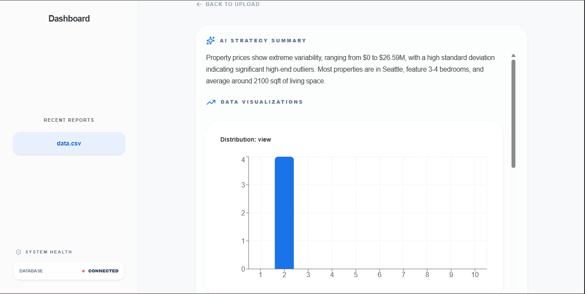
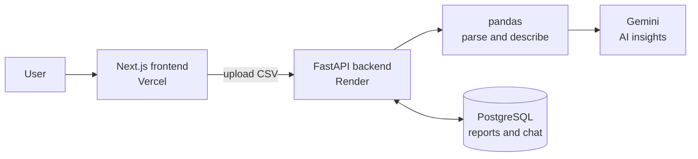

# CSVDashboard

Upload a CSV file and get an instant data preview, summary statistics, AI-generated insights, charts, and a chat assistant that answers follow-up questions about your data.

**Live demo:** [Vercel link](https://csv-dashboard-ashen.vercel.app/)



## Features

- **Upload any CSV** and preview the data table
- **Summary statistics** computed with pandas
- **AI insights** from Google Gemini: trends, outliers, and what to check next
- **Automatic charts** (bar, line, scatter) built from numeric columns with Recharts
- **Follow-up chat** about your dataset, with history saved per report
- **Saved reports** stored in PostgreSQL, with a sidebar of recent reports

## Tech stack

| Layer | Technology |
| --- | --- |
| Frontend | Next.js (App Router), React, Recharts |
| Backend | Python, FastAPI, pandas |
| Database | PostgreSQL, SQLAlchemy (JSONB columns) |
| AI | Google Gemini (`gemini-2.5-flash`) |
| Hosting | Vercel (frontend), Render (backend and database) |

<<<<<<< Updated upstream
  This project is a CSV Dashboard — a web app that lets users upload CSVs, preview the table, generate short AI insights (trends, outliers, recommendations), save reports, view recent reports, and export results.

  ## Project Snapshot
  - Chosen problem: CSV Dashboard
  - Tech stack: Python (FastAPI), PostgreSQL, SQLAlchemy, Pandas, Google Gemini (generative AI), Next.js (React), Recharts
=======
## Architecture


>>>>>>> Stashed changes

1. The frontend sends the CSV to `/upload`.
2. The backend parses it with pandas, computes summary statistics, and sends them to Gemini for insights.
3. The preview, statistics, insights and chat history are saved as a report in PostgreSQL and returned to the frontend.

## API endpoints

| Method | Path | Purpose |
| --- | --- | --- |
| GET | `/health` | Service and database health check |
| POST | `/upload` | Upload a CSV, analyse it, and save a report |
| GET | `/reports/recent` | List the 10 most recent reports |
| GET | `/reports/{id}` | Get a single report |
| POST | `/reports/{id}/chat` | Ask a follow-up question about a report |

Interactive API docs are available at `/docs` when the backend is running.

## Getting started

### Prerequisites

- Python 3.10+
- Node.js 18+
- PostgreSQL (local or hosted)
- A Google Gemini API key

### Environment variables

Copy the example files and fill in your values:

```bash
cp Backend/.env.example Backend/.env
cp frontend/.env.example frontend/.env
```

On Windows (PowerShell):

```powershell
Copy-Item Backend\.env.example Backend\.env
Copy-Item frontend\.env.example frontend\.env
```

| Variable | Where | Description |
| --- | --- | --- |
| `DATABASE_URL` | Backend | PostgreSQL connection string. Use the `postgresql+psycopg2://` prefix (see Deployment). |
| `GEMINI_API_KEY` | Backend | Your Google Gemini API key |
| `PORT` | Backend | Port for the backend server (default 8000) |
| `NEXT_PUBLIC_API_BASE` | Frontend | URL of the backend, e.g. `http://localhost:8000` |

### Run the backend

```bash
cd Backend
python -m venv .venv
# Windows: .venv\Scripts\activate
# macOS/Linux: source .venv/bin/activate
pip install -r requirements.txt
uvicorn app:app --reload --host 0.0.0.0 --port 8000
```

### Run the frontend

```bash
cd frontend
npm install
npm run dev
```

Then open http://localhost:3000.

## Project structure

```
CSVDashboard/
├── Backend/
│   ├── app.py              # FastAPI app and endpoints
│   ├── db.py               # SQLAlchemy engine and session
│   ├── models.py           # Report model (JSONB fields)
│   ├── requirements.txt    # Python dependencies
│   └── .env.example        # Example backend environment variables
└── frontend/
    ├── app/                # Next.js pages (page.tsx, globals.css)
    ├── components/         # Sidebar, InsightsView, VisualizationsView, ChatInterface
    ├── lib/api.ts          # API client
    └── .env.example        # Example frontend environment variables
```

## Deployment

**Backend (Render):**
- Start command: `uvicorn app:app --host 0.0.0.0 --port $PORT`
- Set `DATABASE_URL` and `GEMINI_API_KEY` in the service's environment variables.
- SQLAlchemy 2.x treats a plain `postgresql://` URL as the psycopg v3 driver. This project uses `psycopg2-binary`, so the URL must start with `postgresql+psycopg2://`. Hosting providers give you a plain `postgresql://` URL, so update the prefix whenever you copy a new one.

**Frontend (Vercel):**
- Set `NEXT_PUBLIC_API_BASE` to your deployed backend URL.

## Security

- Secrets are kept in environment variables and never committed.
- `.gitignore` excludes `.env*`, `secrets/`, `secrets.json`, `*.key`, `*.secret` and `credentials`.
- Use a hosted PostgreSQL database in production, not SQLite.

## Roadmap

- [ ] **Data cleaning pipeline:** column profiling, column-type detection, cleaning by type, and an undoable change report
- [ ] **Outlier detection:** IQR and z-score per column, rule checks, and Isolation Forest across columns
- [ ] **Evaluation:** measure detection accuracy on datasets with injected errors
- [ ] **Background jobs** for large files, with job status tracking
- [ ] **User accounts** with JWT login and private reports
- [ ] **Gemini as an explainer** of the pipeline's findings, rather than the source of them

## License

Add a license here, e.g. MIT.

## Contact

Sanjay Varma · [GitHub](https://github.com/sanjayvarma2001) · [LinkedIn](https://linkedin.com/in/sanjayvarmamalladi)