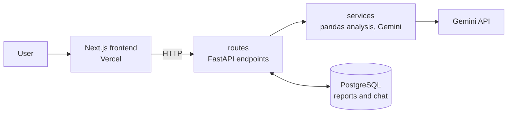

# CSVDashboard

Upload a CSV file and get an instant data preview, summary statistics, AI-generated insights, charts, and a chat assistant that answers follow-up questions about your data.

**Live demo:** [Vercel link](https://csv-dashboard-ashen.vercel.app/)

> Currently being upgraded with a data cleaning and outlier detection pipeline. See the [Roadmap](#roadmap).


## Features

- **Upload any CSV** and preview the data table
- **Summary statistics** computed with pandas
- **AI insights** from Google Gemini: trends, outliers, and what to check next
- **Automatic charts** (bar, line, scatter) built from numeric columns with Recharts
- **Follow-up chat** about your dataset, with history saved per report
- **Saved reports** stored in PostgreSQL, with a sidebar of recent reports

## Tech stack

| Layer | Technology |
| --- | --- |
| Frontend | Next.js (App Router), React, Recharts |
| Backend | Python, FastAPI, pandas |
| Database | PostgreSQL, SQLAlchemy (JSONB columns) |
| AI | Google Gemini via the `google-genai` SDK |
| Tooling | pytest, ruff, Docker |
| Hosting | Vercel (frontend), Render (backend and database) |

## Architecture



1. The frontend sends the CSV to `/upload`.
2. The route reads the file and passes it to the services layer, which computes summary statistics with pandas and asks Gemini for insights.
3. The preview, statistics, insights and chat history are saved as a report in PostgreSQL and returned to the frontend.

The backend is layered so each part has one job: **routes** handle HTTP, **services** hold the business logic, **models** define the database tables, **schemas** validate request data, and **core** reads configuration.

## API endpoints

| Method | Path | Purpose |
| --- | --- | --- |
| GET | `/health` | Service and database health check |
| POST | `/upload` | Upload a CSV, analyse it, and save a report |
| GET | `/reports/recent` | List the 10 most recent reports |
| GET | `/reports/{id}` | Get a single report |
| POST | `/reports/{id}/chat` | Ask a follow-up question about a report |

Interactive API docs are available at `/docs` when the backend is running.

## Getting started

### Prerequisites

- Python 3.12 or newer
- Node.js 18+
- PostgreSQL running locally (or a hosted database)
- A Google Gemini API key

### Environment variables

Copy the example files and fill in your values:

```bash
cp Backend/.env.example Backend/.env
cp frontend/.env.example frontend/.env
```

On Windows (PowerShell):

```powershell
Copy-Item Backend\.env.example Backend\.env
Copy-Item frontend\.env.example frontend\.env
```

| Variable | Where | Description |
| --- | --- | --- |
| `DATABASE_URL` | Backend | PostgreSQL connection string. The `postgresql+psycopg2://` driver prefix is added automatically. |
| `GEMINI_API_KEY` | Backend | Your Google Gemini API key |
| `MODEL_NAME` | Backend | Gemini model to use, e.g. `gemini-2.5-flash` |
| `FRONTEND_ORIGINS` | Backend | Comma-separated origins allowed by CORS, e.g. `http://localhost:3000` |
| `NEXT_PUBLIC_API_BASE` | Frontend | URL of the backend, e.g. `http://localhost:8000` |

The backend checks the required variables at startup and stops with a clear error if any are missing.

### Run the backend

```bash
cd Backend
python -m venv venv
# Windows: venv\Scripts\activate
# macOS/Linux: source venv/bin/activate
pip install -r requirements-dev.txt
uvicorn main:app --reload
```

`requirements.txt` holds the pinned production dependencies; `requirements-dev.txt` adds the testing and linting tools.

### Run the frontend

```bash
cd frontend
npm install
npm run dev
```

Then open http://localhost:3000.

### Tests and linting

From the `Backend` folder:

```bash
pytest -v        # run the API tests
ruff check .     # lint the code
```

## Project structure

```
CSVDashboard/
├── Backend/
│   ├── main.py              # Entry point: creates the app, CORS, includes routers
│   ├── core/
│   │   └── config.py        # Reads and validates environment variables
│   ├── db/
│   │   └── database.py      # SQLAlchemy engine, session, get_db dependency
│   ├── models/
│   │   └── report.py        # Report table (JSONB fields)
│   ├── schemas/
│   │   └── report.py        # Pydantic request models
│   ├── routes/
│   │   ├── health.py        # GET /health
│   │   ├── reports.py       # Upload, recent reports, report by ID
│   │   └── chat.py          # Follow-up chat
│   ├── services/
│   │   ├── analysis.py      # pandas statistics and report creation
│   │   └── llm.py           # Gemini insights and chat
│   ├── tests/
│   │   └── test_api.py      # pytest tests using FastAPI's TestClient
│   ├── requirements.txt     # Pinned production dependencies
│   ├── requirements-dev.txt # Adds pytest, httpx, ruff
│   ├── ruff.toml            # Linter settings
│   └── .env.example         # Example backend environment variables
├── frontend/
│   ├── app/                 # Next.js pages (page.tsx, globals.css)
│   ├── components/          # Sidebar, InsightsView, VisualizationsView, ChatInterface
│   ├── lib/api.ts           # API client
│   └── .env.example         # Example frontend environment variables
├── docs/                    # Screenshots
├── Dockerfile               # Backend container image
├── render.yaml              # Render service definition
└── .dockerignore
```

## Deployment

**Backend (Render, Docker):**
- Render builds the image from the `Dockerfile`, which starts the app with `uvicorn main:app` on the port Render provides (`$PORT`).
- Render checks `/health` after each deploy before switching traffic to the new version.
- Set `DATABASE_URL`, `GEMINI_API_KEY`, `MODEL_NAME` and `FRONTEND_ORIGINS` in the service's environment variables. `FRONTEND_ORIGINS` should be the deployed frontend URL, with no trailing slash.
- Dependency versions are pinned in `requirements.txt` so local and production installs match.

**Frontend (Vercel):**
- Set `NEXT_PUBLIC_API_BASE` to your deployed backend URL.

## Security

- Secrets are kept in environment variables and never committed; `.env.example` contains placeholders only.
- CORS only allows the origins listed in `FRONTEND_ORIGINS`.
- `.gitignore` excludes `.env*` (except `.env.example`), `secrets/`, `*.key`, `*.secret` and `credentials`.

## Documentation

- [AI_NOTES.md](AI_NOTES.md): how AI is used in the app and during development
- [PROMPTS_USED.md](PROMPTS_USED.md): prompts used while building the project
- [DEPLOYMENT_GUIDE.md](DEPLOYMENT_GUIDE.md): detailed deployment steps

## Roadmap

- [x] **Layered backend structure:** routes, services, models, schemas and config; new Gemini SDK; pinned dependencies; pytest and ruff
- [ ] **Data cleaning pipeline:** column profiling, column-type detection, cleaning by type, and an undoable change report
- [ ] **Outlier detection:** IQR and z-score per column, rule checks, and Isolation Forest across columns
- [ ] **Evaluation:** measure detection accuracy on datasets with injected errors
- [ ] **Background jobs** for large files, with job status tracking
- [ ] **User accounts** with JWT login and private reports
- [ ] **CI pipeline:** lint, test and build checks on every pull request
- [ ] **Gemini as an explainer** of the pipeline's findings, rather than the source of them

## License

This project is licensed under the MIT License. See [LICENSE](LICENSE) for details.

## Contact

Sanjay Varma · [GitHub](https://github.com/sanjayvarma2001) · [LinkedIn](https://linkedin.com/in/sanjayvarmamalladi)